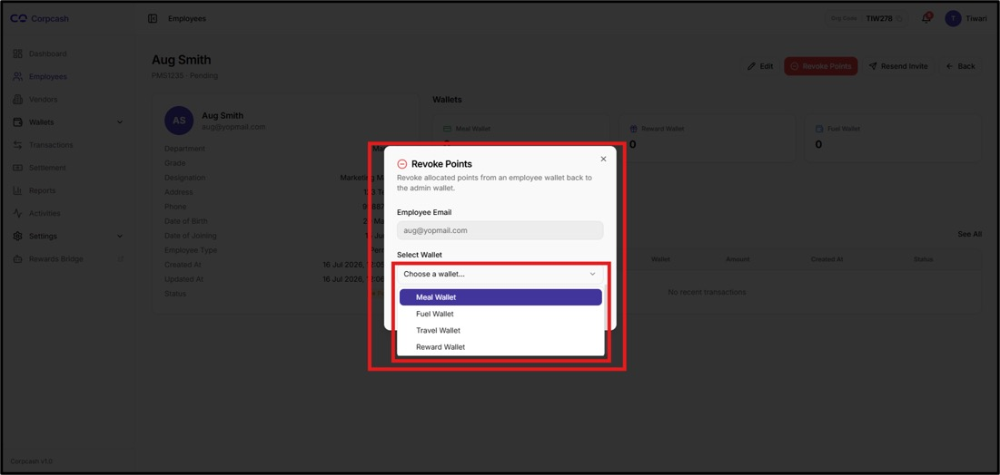

# View Employee Details

To view the details of an employee, navigate to the Employees module from the left-side navigation menu. Locate the required employee from the employee directory and click View under the Actions column.

<figure><figcaption></figcaption></figure>

The system redirects the administrator to the corresponding Employee Details page. The employee's name and account information are displayed at the top of the page, followed by the employee profile, wallet information, and recent transaction sections.

**For example:**

**Aug Smith**\
**PMS1235 · Pending**

This allows the administrator to immediately identify the employee and understand the current state of the employee account.

The Employee Actions section is available in the upper-right corner of the Employee Details page and provides administrators with the options required to manage the selected employee. These actions allow the administrator to perform employee-level operations directly from the employee's details page without navigating back to the main Employees directory.

The available actions are Edit, Revoke Points, Resend Invite, and Back. Each action serves a specific administrative purpose and should be used according to the employee's current status and the organization's configured policies.

#### Edit

The Edit option allows the administrator to modify the information associated with the selected employee. When the administrator clicks Edit, the system opens the employee information in an editable form, allowing authorized details to be updated.

<figure><figcaption></figcaption></figure>

To edit an employee:



### Open employee's page.

To open the employee page click on **"View"** button as shown in the image below.

<figure><figcaption></figcaption></figure>



### Edit Details.

Click on "Edit" button to make the changes.

<figure><figcaption></figcaption></figure>



### Editable Form

As soon as the user clicks on the “Edit” button a new window will open and allow the user to modify the required employee information as shown in the image below.

<figure><figcaption></figcaption></figure>

> After making changes or editing the details, users must review the updated information before final submission to avoid unnecessary repetition.



### Save and Close

Once reviewed click on **“Save Changes”** for final submission.

<figure><figcaption></figcaption></figure>



After the changes are successfully saved, the employee record is updated and the Updated At information may reflect the latest modification.


The fields available for modification and the applicable validation rules depend on the employee-management configuration and administrator permissions.


The administrator should review the existing information and make the necessary changes to the employee's profile. After updating the required fields, the administrator should carefully verify the entered information and save or submit the changes. Once the changes are successfully saved, the employee record is updated in the system, and the Updated At field reflects the latest modification.

### Revoke Points

The Revoke Points option enables an authorized administrator to revoke points that have previously been allocated to the selected employee. This functionality can be used when points have been issued incorrectly, need to be reversed, or when a correction is required according to the organization's business process.

Before proceeding with the revocation, the administrator should verify the employee's identity and carefully review the applicable points or wallet information. After selecting the required points to be revoked, the administrator should review the details and confirm the action. Since revoking points may affect the employee's available balance, this operation should only be performed by an authorized administrator after verifying that the revocation is required.

<figure><figcaption></figcaption></figure>

The administrator should carefully review the information presented by the system before confirming the operation.

Important: Point revocation may affect the employee's available wallet balance. Administrators should perform this action only when authorized and after verifying the relevant transaction or allocation.



### Revoke

To revoke the allocated point the employee click on the the **“Revoke”** button in yellow color

<figure><figcaption></figcaption></figure>



### Select Wallet Type

Once a user clicks on this a new pop-up modal will open as shown in the image. Now users must select the wallet type for which user wants to revoke the points.

> **Revoke Type wallet is not visible below this page (GT NOTES)**

<figure><figcaption></figcaption></figure>

Given Wallet Type

1. Meal wallet
2. Fuel wallet
3. Travel wallet
4. Reward wallet



#### Resend Invite

<figure><figcaption></figcaption></figure>

The Resend Invite option allows the administrator to resend the employee invitation to the registered email address. This option is particularly useful when an employee has not received the original invitation or has not completed the required account activation or onboarding process.

To resend the invitation, the administrator should first verify that the correct employee record is open and that the registered email address is accurate. The administrator can then click Resend Invite and confirm the action, if prompted by the system. The system sends the invitation again using the configured invitation mechanism.

This option is especially relevant for employees whose account status is Pending, as they may still be awaiting completion of the onboarding or account activation process.

#### Back

<figure><figcaption></figcaption></figure>

The Back option allows the administrator to return to the previous Employees page after reviewing or managing the selected employee. Clicking Back takes the administrator back to the employee directory, where they can search for another employee, review additional records, or perform other employee-management activities.

The Back option does not modify the employee record; it is provided solely for navigation between the Employee Details page and the main Employees directory.
