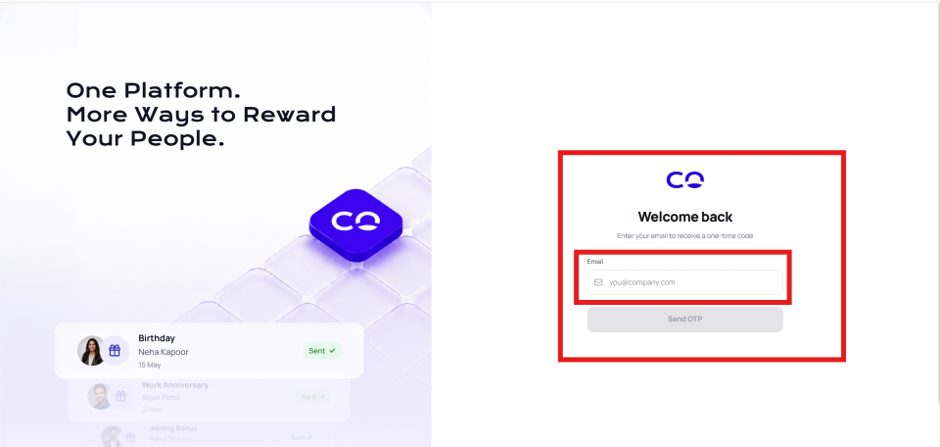

# Transaction

The Transactions module provides a centralized interface for monitoring transaction activity performed across the organization's configured services and wallets. It enables administrators to review transaction records associated with employees, vendors, and applicable transaction categories from a single interface.

The Transactions page provides administrators with transaction-level visibility, including the Transaction ID, Vendor, Employee, Transaction Type, Amount, Updated At, Created At, and Status. Administrators can also search for specific transactions, filter transactions based on the selected transaction category or vendor, export transaction records, and review the processing status of individual transactions.

The module is particularly useful for transaction monitoring, operational review, reconciliation, audit activities, and investigation of wallet-related activity.

### Accessing the Transactions Module



### Log in

Log in to the CorpCash application using valid credentials.

<figure><figcaption></figcaption></figure>



### Navigation

Locate the navigation menu on the left side of the screen.

<figure><figcaption></figcaption></figure>



### Click Transactions.

The Transactions page opens.

<figure><figcaption></figcaption></figure>



#### Transaction Category

At the top of the Transactions page, the system provides category tabs that allow administrators to switch between different types of transaction views.

The tabs visible in the provided interface are:

* All
* Gift Card
* Vendors

<figure><figcaption></figcaption></figure>

**All**

The All tab is intended to provide a consolidated view of transaction activity across the available transaction categories. Administrators can use this tab when they need to review the overall transaction activity rather than transactions belonging to a specific category.

<figure><figcaption></figcaption></figure>

<table data-header-hidden><thead><tr><th width="111"></th><th></th></tr></thead><tbody><tr><td>Field</td><td>Description</td></tr><tr><td>ET ID</td><td>Represents the unique Employee Transaction ID assigned to the transaction. It serves as a primary reference for identifying, tracking, and investigating an employee-related transaction within the CorpCash platform. </td></tr><tr><td>ST ID</td><td>Represents the Service Transaction ID associated with the transaction. It provides a reference to the transaction generated within the relevant service workflow. If a service transaction is not applicable, the system may display “–”.</td></tr><tr><td>Employee</td><td>Displays the name of the employee associated with the transaction. This field enables administrators to identify the employee for whom or by whom the transaction was generated. </td></tr><tr><td>Employee Email</td><td>Displays the registered email address of the employee associated with the transaction. It provides an additional identifier for verifying the employee's account and is useful when multiple employees have similar names. </td></tr><tr><td>Service</td><td>Identifies the service or business operation through which the transaction was generated. Examples include Admin Transfer, Vendor Payment, and Gift Card.</td></tr><tr><td>Walle</td><td>Identifies the wallet category associated with the transaction. Examples include Meal and Reward. This field indicates the wallet affected by the transaction. </td></tr><tr><td>Amount</td><td>Displays the transaction value associated with the selected transaction record. Administrators can use this field to verify the amount involved during transaction monitoring and reconciliation. </td></tr><tr><td>Created A</td><td>Displays the date and time when the transaction was created in the CorpCash system. This timestamp is useful for establishing the transaction timeline and reviewing transactions within a specific period. </td></tr><tr><td>Status</td><td>Indicates the current processing state of the transaction. The interface may display statuses such as Success, Pending, or Failed, allowing administrators to determine whether the transaction has been successfully processed or requires further attention. </td></tr><tr><td>Action</td><td>Provides the available transaction-level operation. In the displayed interface, the View option allows the administrator to open and review detailed information associated with the selected transaction. </td></tr></tbody></table>

**Gift Card**

The Gift Card tab provides access to transactions associated with the Gift Card category, where applicable.

Administrators can select this tab when they need to review transactions specifically related to the configured Gift Card service.

<figure><figcaption></figcaption></figure>

When the Gift Card tab is selected, the transaction table displays gift card-specific records. The table provides the following fields:

<table data-header-hidden><thead><tr><th width="125"></th><th></th></tr></thead><tbody><tr><td>Field</td><td>Description</td></tr><tr><td>ID</td><td>Represents the unique transaction identifier assigned to the Gift Card transaction. It is used to identify and track the transaction within the CorpCash platform and can be referenced during transaction verification, reconciliation, or investigation. </td></tr><tr><td>Reference ID</td><td>Represents the reference identifier associated with the Gift Card transaction. It provides an additional transaction-level reference that can be used to trace the transaction across the applicable Gift Card service workflow.</td></tr><tr><td>Employee</td><td>Displays the name of the employee associated with the Gift Card transaction. This field identifies the employee for whom the Gift Card transaction was initiated or processed.</td></tr><tr><td>Email</td><td>Displays the registered email address associated with the employee. It provides an additional identifier for validating the employee associated with the transaction.</td></tr><tr><td>Brand</td><td>Displays the Gift Card brand associated with the transaction. Examples visible in the interface include Flipkart, Myntra, and Absolute Barbecues. This field identifies the brand for which the Gift Card was issued or purchased. </td></tr><tr><td>Category</td><td>Displays the category associated with the selected Gift Card brand or product. Examples visible in the interface include ONE_STOP_SHOPS_ELECTRONICS, FASHION_RAKHI_SPECIAL, and FOOD. The category helps classify the Gift Card according to the applicable product or service category.</td></tr><tr><td>Wallet</td><td>Identifies the employee wallet from which the Gift Card transaction is associated or funded. Examples visible in the interface include Reward and Meal.</td></tr><tr><td>Amount</td><td>Displays the amount deducted or allocated for the Gift Card transaction from the applicable wallet. This represents the transaction value processed through CorpCash.</td></tr><tr><td>Worth</td><td>Displays the face value or monetary worth of the Gift Card associated with the transaction. The Worth may differ from the Amount depending on the applicable Gift Card pricing, discount, or business rules. </td></tr><tr><td>Created At</td><td>Displays the date and time when the Gift Card transaction was created in the CorpCash system. This timestamp provides the transaction's creation time and can be used for chronological tracking and reconciliation. </td></tr><tr><td>Status</td><td>Indicates the current processing status of the Gift Card transaction. The interface displays statuses such as Success, Pending, and Failed, allowing administrators to determine the outcome of the transaction. </td></tr></tbody></table>

**Vendors**

The Vendors tab provides access to vendor-related transaction activity. This section provides administrators with a consolidated, transaction-level view of all activities associated with vendors. It enables administrators to identify the vendor involved in a transaction, determine whether the transaction is a wallet credit or cash-out request, review the associated employee, verify the transaction amount, monitor transaction timestamps, and confirm the processing status.

<figure><figcaption></figcaption></figure>

Note: The transaction categories available in the interface may vary depending on the services and features enabled for the organization.

<table data-header-hidden><thead><tr><th width="154"></th><th></th></tr></thead><tbody><tr><td>Field</td><td>Description</td></tr><tr><td>Transaction ID</td><td>Displays the unique identifier assigned to the vendor transaction. This ID acts as the primary reference for identifying and tracking an individual transaction within CorpCash. It can be used for reconciliation, investigation, audit, and support-related activities. </td></tr><tr><td>Vendor</td><td>Displays the name of the vendor associated with the transaction. This field enables administrators to identify the vendor involved in the transaction and review vendor-specific transaction activity. </td></tr><tr><td>Employee</td><td>Displays the name of the employee associated with the transaction, where applicable. If the transaction does not have a directly associated employee, the system displays “—”. This field helps administrators trace transactions back to the employee involved. </td></tr><tr><td>Type</td><td>Identifies the type of vendor transaction recorded in the system. The provided interface displays transaction types such as wallet_credit and cashout_request.</td></tr><tr><td>Amount</td><td>Displays the monetary or wallet value associated with the transaction. Administrators can use this field to verify the value processed through the transaction and perform reconciliation against applicable records. </td></tr><tr><td>Updated At</td><td>Displays the date and time when the transaction record was last updated in the system. This timestamp can be used to understand the latest modification or processing activity associated with the transaction.</td></tr><tr><td>Created At</td><td>Displays the date and time when the transaction record was initially created. It provides the original transaction timestamp and is useful for establishing the chronological sequence of vendor transactions.</td></tr><tr><td>Status</td><td>Displays the current processing status of the transaction. In the provided interface, the visible transactions are marked Success, indicating that they have been successfully processed. </td></tr></tbody></table>

#### Search & Filter Transactions

<figure><figcaption></figcaption></figure>

The Transactions page provides comprehensive search and filtering capabilities that enable administrators to efficiently locate and analyze specific transaction records. These controls allow the transaction dataset to be narrowed based on relevant identifiers and attributes, reducing the need to manually review the complete transaction history.

**Search Transactions**

The Search field enables administrators to locate transaction records using supported vendor or employee related information. Administrators can enter relevant search criteria, such as the Vendor Name, Employee Name, or Employee Email Address, to retrieve matching transaction records.

The search functionality dynamically narrows the transaction list based on the entered search value and displays the records that match the specified criteria. This enables administrators to quickly identify transactions associated with a particular vendor or employee and is particularly useful for transaction investigation, reconciliation, and operational monitoring.

For example, an administrator can enter an employee's name to retrieve transactions associated with that employee or enter a vendor name to review transactions associated with a specific vendor. Similarly, an employee's registered email address can be used to identify the corresponding transaction records.

**Filters**

In addition to the search functionality, the Transactions page provides filter controls that allow administrators to further refine the transaction results. Search and filter criteria can be used independently or in combination to narrow the result and retrieve a more specific result of transaction records.

By applying appropriate filters, administrators can isolate relevant records for transaction monitoring, reconciliation, auditing, reporting, and investigation.

The **Transactions** module provides multiple tools for locating and narrowing transaction records. These functionalities are available above the transaction table and allow users to quickly identify the required transactions without manually reviewing the complete transaction list.

The filtering contains the following :

1. **Status Filter**
2. **Service Filter**
3. **Wallet Filter**
4. **Period Filter**

This section describes the **Status, Service, and Wallet** filter functionalities in detail.

### Status Filter

The **Status** filter allows users to narrow transaction records according to the current state of the transaction.

The Status filter is available above the transaction table alongside the Search and other filter controls.

<figure><figcaption></figcaption></figure>

The Transactions module uses status information to distinguish between transactions that have completed successfully, are still being processed, or have not completed successfully.

#### Status Categories

The Transactions interface represents the following status categories:

<table><thead><tr><th width="105">Status</th><th width="236">Description</th><th>Typical Use</th></tr></thead><tbody><tr><td><strong>Success</strong></td><td>Transaction has completed successfully.</td><td>Review completed transactions</td></tr><tr><td><strong>Pending</strong></td><td>Transaction has not reached a final state.</td><td>Monitor transactions awaiting completion</td></tr><tr><td><strong>Failed</strong></td><td>Transaction was not completed successfully.</td><td>Investigate unsuccessful transactions</td></tr><tr><td><strong>Rejected</strong></td><td>Transaction was rejected, where applicable.</td><td>Review rejected transactions</td></tr></tbody></table>

## Step-by-Step Process – Applying Status Filter



### Open Transactions

* Navigate to **Transactions**.
* The transaction listing is displayed.

<figure><figcaption></figcaption></figure>



### Open Status Filter

* Locate the filter bar above the transaction table.
* Click **Status**.
* The available status options are displayed.

<figure><figcaption></figcaption></figure>



### Select Status

* Select the required status.
* The selected status is applied to the transaction listing.

<figure><figcaption></figcaption></figure>



### Review Results

* Review the updated transaction table.
* Only the transactions matching the selected status are displayed.
* Review the transaction information.

<figure><figcaption></figcaption></figure>



### Service Filter

The **Service** filter allows users to filter transactions according to the service associated with the transaction.

When the Service dropdown is opened, the interface displays the following options:

<table><thead><tr><th width="158">Service Option</th><th>Description</th></tr></thead><tbody><tr><td><strong>All</strong></td><td>Displays transactions across all available services.</td></tr><tr><td><strong>Gift Card</strong></td><td>Filters transactions associated with Gift Card services.</td></tr><tr><td><strong>Wallet Top-up</strong></td><td>Filters wallet top-up transactions.</td></tr><tr><td><strong>Vendor Payment</strong></td><td>Filters transactions associated with vendor payments.</td></tr><tr><td><strong>Treasury Transfer</strong></td><td>Filters transactions associated with treasury transfers.</td></tr><tr><td><strong>Service Fee</strong></td><td>Filters transactions associated with service fees.</td></tr><tr><td><strong>Cashout</strong></td><td>Filters cashout-related transactions.</td></tr></tbody></table>

The available options shown in the provided interface are therefore:

> **All, Gift Card, Wallet Top-up, Vendor Payment, Treasury Transfer, Service Fee, Cashout**

## Step-by-Step Process – Applying Service Filter



### Open Transactions

* Navigate to **Transactions**.
* Locate the transaction table.

<figure><figcaption></figcaption></figure>



### Open Service Filter

* Locate **Service** in the filter bar.
* Click **Service**.
* The service options are displayed.

<figure><figcaption></figcaption></figure>



### Select Service

* Review the available services.
* Select the required service.

<figure><figcaption></figcaption></figure>



### Review Filtered Transactions

1. The transaction list is updated according to the selected service.
2. Review the resulting records.

<figure><figcaption></figcaption></figure>



### Wallet Filter

The **Wallet** filter allows users to filter transactions according to the wallet associated with the transaction.

When the Wallet dropdown is opened, the interface displays the following options:

<table><thead><tr><th width="152">Wallet Option</th><th>Description</th></tr></thead><tbody><tr><td><strong>All</strong></td><td>Displays transactions associated with all available wallets.</td></tr><tr><td><strong>Admin</strong></td><td>Filters transactions associated with the Admin wallet.</td></tr><tr><td><strong>Treasury</strong></td><td>Filters transactions associated with the Treasury wallet.</td></tr><tr><td><strong>Service</strong></td><td>Filters transactions associated with the Service wallet.</td></tr><tr><td><strong>Employee</strong></td><td>Filters transactions associated with the Employee wallet.</td></tr><tr><td><strong>Vendor</strong></td><td>Filters transactions associated with the Vendor wallet.</td></tr><tr><td><strong>Meal</strong></td><td>Filters transactions associated with the Meal wallet.</td></tr></tbody></table>

## Step-by-Step Process – Applying Wallet Filter



### Open Transactions

* Navigate to **Transactions**.
* Locate the filter bar above the transaction table.

<figure><figcaption></figcaption></figure>



### Open Wallet Filter

* Click **Wallet**.
* The available wallet options are displayed.

<figure><figcaption></figcaption></figure>



### Select Wallet

* Review the available wallet options.
* Select the required wallet.

<figure><figcaption></figcaption></figure>



### Review Results

* The transaction list is updated.
* Review the displayed transactions.
* Verify the Wallet column to confirm that the records belong to the selected wallet.

<figure><figcaption></figcaption></figure>



#### Export Transactions

<figure><figcaption></figcaption></figure>

The Export Transactions functionality enables authorized administrators to extract transaction records from the Transactions module for external analysis, reporting, reconciliation, auditing, and record-keeping purposes.

The Export button is available in the upper-right corner of the Transactions page and provides a convenient mechanism for obtaining transaction data outside the CorpCash interface.

Before exporting transaction data, administrators should apply the appropriate transaction category, search criteria, and filters if only a specific subset of transactions is required.

**Exporting Filtered Transactions**

When the administrator needs to export only specific transaction records, the required search and filter criteria should be applied before selecting Export.

For example, the administrator may:

1. Select the required transaction category, such as All, Gift Card, or Vendors.
2. Enter a relevant Transaction ID, Vendor Name, Employee Name, or Employee Email in the search field.
3. Select the required Status.
4. Select the required Transaction Type.
5. Specify the required Date Range.
6. Apply any additional available filters.
7. Review the resulting transaction records.
8. Select Export.

This approach enables administrators to generate a focused transaction dataset relevant to a specific business requirement.

### Pagination and Transaction Count

At the bottom of the transaction table, the system displays the current range of records being shown.

<figure><figcaption></figcaption></figure>
