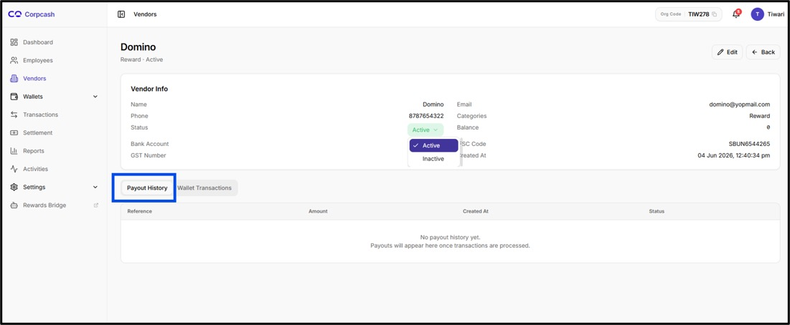
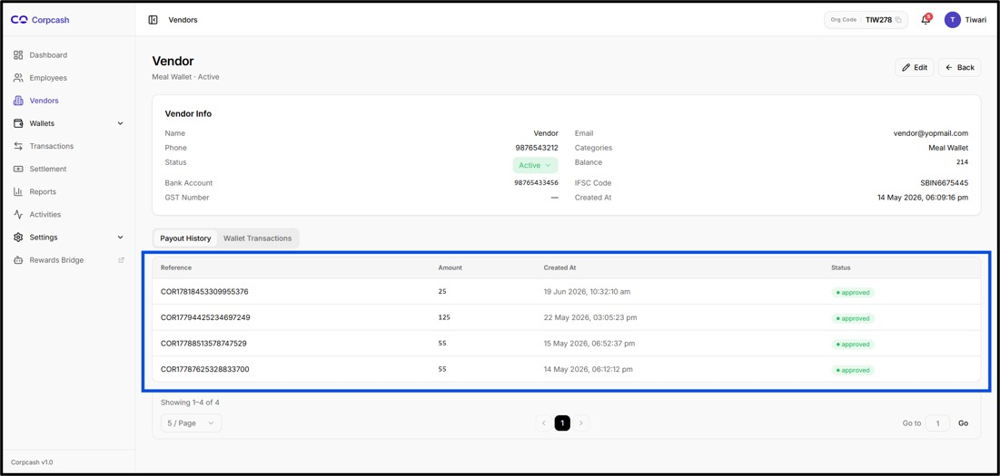

# Payout History

<figure><figcaption></figcaption></figure>

The Payout History tab provides administrators with access to the vendor's payout-related transaction history.

The tab is available below the Vendor Info section.

When payout records are available, the administrator can use this section to review information related to payouts that have been processed for the vendor.

The payout history table contains the following fields:

●     Reference

●     Amount

●     Created At

●     Status

<figure><figcaption></figcaption></figure>

**Reference**

The Reference field identifies the payout or associated transaction using the reference information generated by the system.

This reference can be used when tracking or investigating a particular payout.

<figure><figcaption></figcaption></figure>

**Amount**

The Amount field displays the amount associated with the payout.

This allows administrators to determine the value of the payout process for the vendor.

<figure><figcaption></figcaption></figure>

**Created At**

The Created At field displays the date and time when the payout record was created.

This information helps administrators identify when the payout was initiated or recorded.

<figure><figcaption></figcaption></figure>

**Status**

The Status field displays the current status of the payout.

The status allows administrators to determine whether the payout has been successfully processed or whether it requires further attention.

<figure><figcaption></figcaption></figure>
