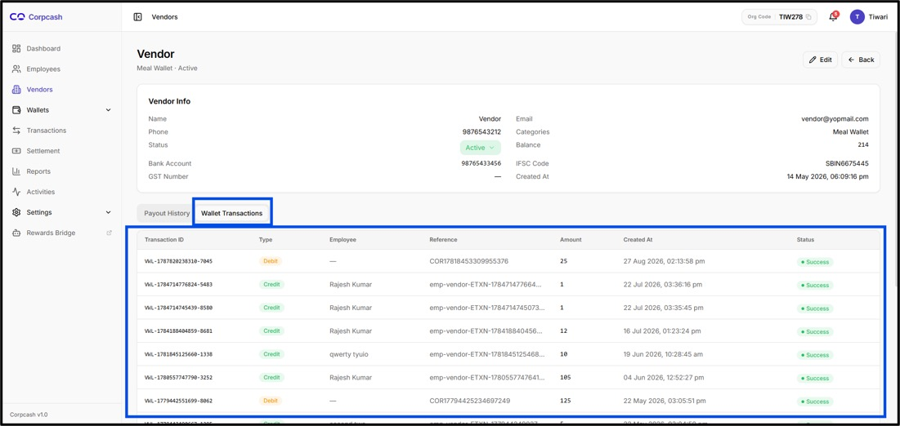
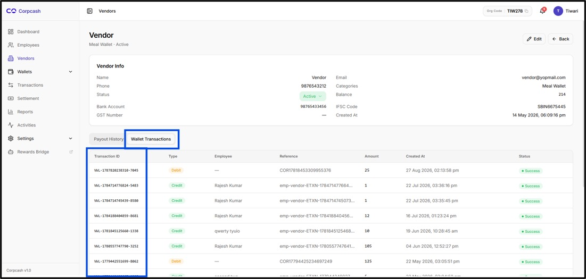
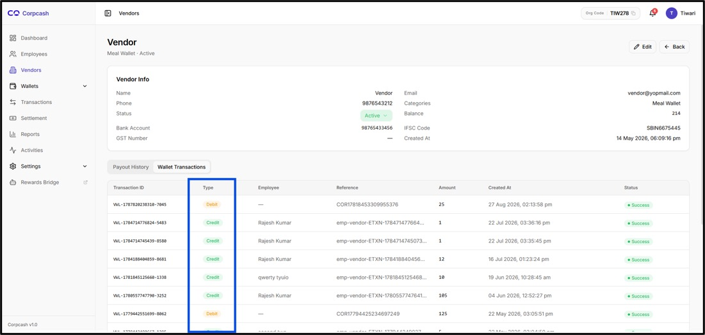
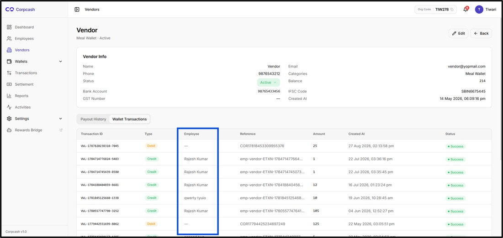
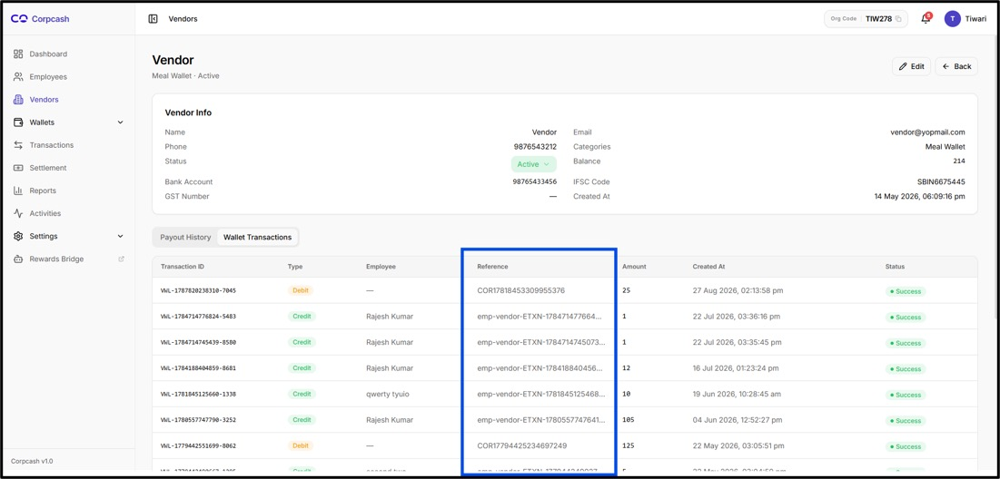
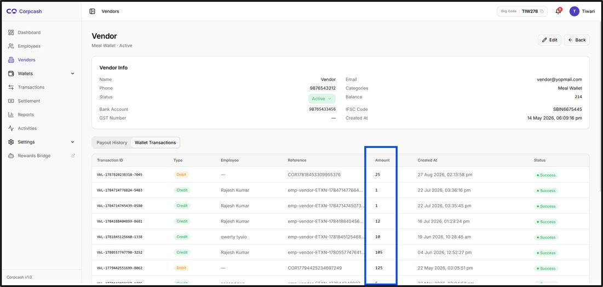
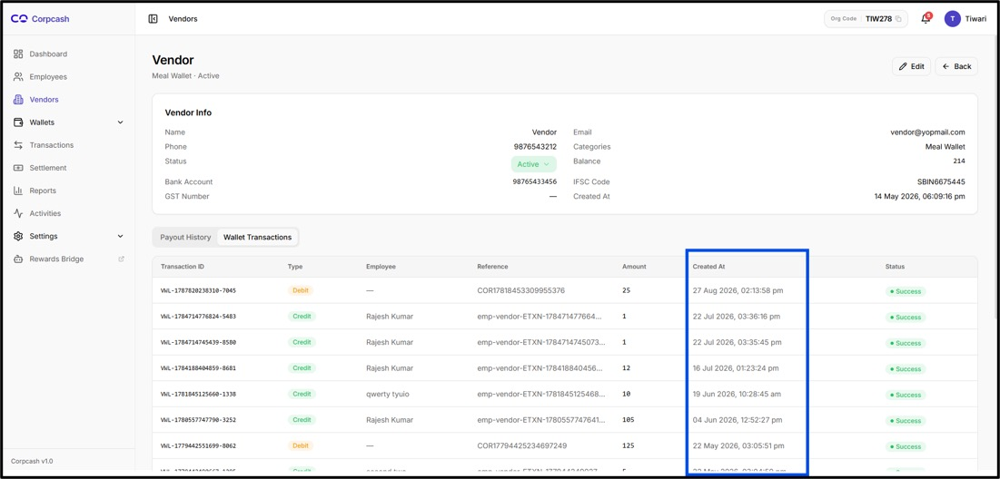
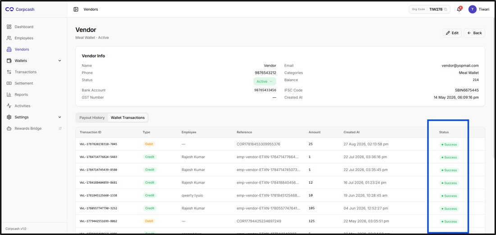

# Wallet Transaction

<figure><figcaption></figcaption></figure>

The Wallet Transactions tab is available alongside the Payout History tab within the Vendor Details page. Selecting Wallet Transactions displays the transaction history associated with the vendor.

The Wallet Transactions section on the Vendor Details page provides administrators with a detailed view of the financial activity associated with the selected vendor's wallet. It enables administrators to review individual wallet transactions, identify whether funds were credited or debited, determine the employee associated with a transaction, review the transaction reference, verify the transaction amount, check when the transaction was created, and confirm the current transaction status.

The Wallet Transactions tab provides a chronological view of transactions associated with the vendor's wallet. Each transaction is presented as an individual row.

The transaction table displayed in the provided interface contains the following columns:

* Transaction ID
* Type
* Employee
* Reference
* Amount
* Created At
* Status

This information enables administrators to trace wallet activity and understand how the vendor's balance has been affected by individual transactions.

Transaction ID

<figure><figcaption></figcaption></figure>

The Transaction ID is a unique identifier assigned to each wallet transaction. It provides a specific reference for identifying and tracking an individual transaction within CorpCash.

Examples visible in the provided screen include:

* VNL-1787820238310-7045
* VNL-1784714776824-5483
* VWL-1784188484859-8681
* VHL-1781845125668-1338

Administrators can use the Transaction ID when investigating a particular transaction, communicating with the support or operations team, or reconciling transaction records.

**Transaction Type**

<figure><figcaption></figcaption></figure>

The Type column identifies the nature of the wallet transaction.

The interface displays two transaction types:

**Credit**

A Credit transaction represents an amount being credited to the vendor's wallet. Such transactions may occur when funds or applicable points are transferred to the vendor from an employee or another configured source.

**Debit**

A Debit transaction represents an amount being deducted from the vendor's wallet.

**Employee**

The Employee column identifies the employee name associated with the wallet transaction.

<figure><figcaption></figcaption></figure>

For transactions initiated or associated with an employee, the employee's name is displayed in this column. Examples visible in the provided screen include:

* Rajesh Kumar
* qwerty tyuio

For transactions where an employee is not directly associated, the system may display a placeholder such as —.

The Employee field is useful when administrators need to trace a vendor transaction back to the employee responsible for or associated with the transaction.

**Reference**

<figure><figcaption></figcaption></figure>

The Reference column contains the reference ID generated for the transaction.

Examples visible in the interface include:

COR17818453309955376

and references beginning with:

emp-vendor-ETXN-...

The reference provides an additional identifier that can be used to trace the transaction across the applicable CorpCash workflow.

Because some references may be longer than the available display area, the interface may truncate the visible value with an ellipsis, such as:

emp-vendor-ETXN-178471477664...

Administrators should use the available transaction details when the complete reference is required for investigation or reconciliation.

**Amount**

<figure><figcaption></figcaption></figure>

The Amount column displays the value associated with the wallet transaction.

The amount should be reviewed together with the Type field to understand whether the value was credited to or debited from the vendor's wallet.

For example, a Credit transaction with an amount of 105 indicates that 105 units were credited through that transaction, while a Debit transaction with an amount of 25 indicates that 25 units were debited.

**Created At**

<figure><figcaption></figcaption></figure>

The Created At column displays the date and time when the transaction was created.

The provided screen contains transaction timestamps such as:

* 27 Aug 2026, 02:13:58 pm
* 22 Jul 2026, 03:36:16 pm

The timestamp helps administrators establish the chronological sequence of transactions and identify when a particular wallet activity occurred.

**Transaction Status**

<figure><figcaption></figcaption></figure>

The Status column indicates the current processing status of each wallet transaction.

**Success**&#x20;


The status is displayed using a green indicator.


A Success status indicates that the corresponding transaction has been successfully processed by the
