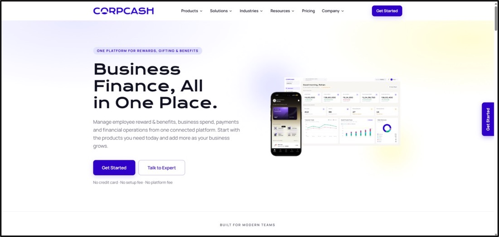
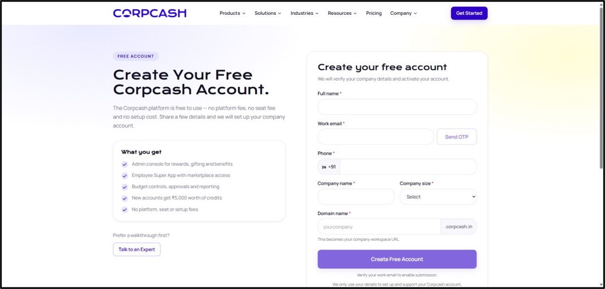
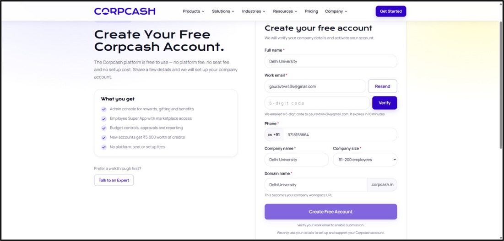
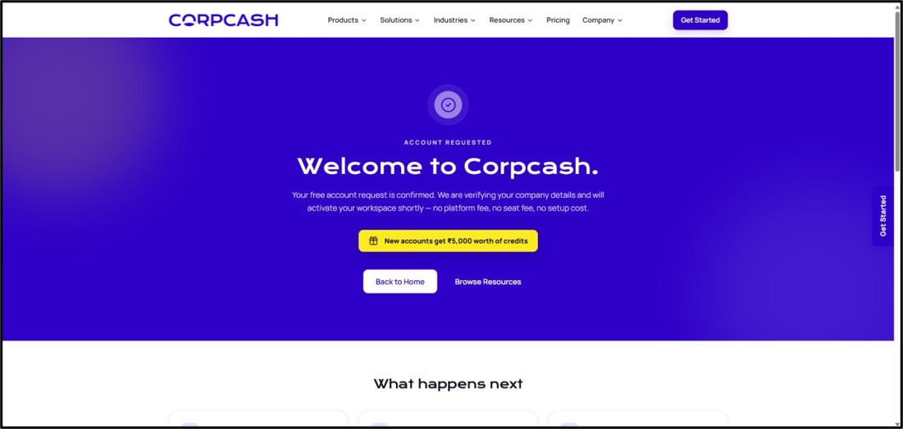

# Self Onboarding


An E-mail will be triggered to the registerd email address to verify the account and provide the costomdomain Url to access the platform.


## Steps



### Visit Corpcash official Website

For Self-Onboarding users need to visit the official website of corpcash [https://corpcash.in/](https://corpcash.in/) . As soon as the user clicks they will land on the website as shown in the below image.



### Home Page


<figure><figcaption></figcaption></figure>



#### Getting Started

Now users must click on the **“Get Started”** button to proceed for the self-onboarding.

<figure><figcaption></figcaption></figure>



#### Registration Detail

Once a user clicks on it a registration form page will be visible where the user must provide the given details as shown in the image below.

<figure><figcaption></figcaption></figure>

```
1.	Full Name 
2.	Work Email
3.	Phone 
4.	Company Name
5.	Company Size
6.	Domain Name
```


DNS changes can take up to 48 hours to propagate, but in practice most see them resolve within a few minutes.




#### OTP Verification

After entering all the required information in the respective fields, click the Send OTP button to initiate the OTP verification process. The system sends a One-Time Password (OTP) to the registered email address associated with the user account.

<figure><figcaption></figcaption></figure>



### Enter OTP

Once the OTP is successfully sent, the OTP input field is enabled and displayed on the screen. Enter the OTP received on the registered email address in the designated field. After entering the OTP, verify that the entered value is correct and proceed with the next step to complete the process.

<figure><figcaption></figcaption></figure>


If the OTP is not received, check the registered email address and, if available, use the Resend OTP option to request a new OTP.




### Registration Approval

Once the OTP verification is completed successfully, the user is redirected to the Home page, as shown in the image. At this stage, the user's registration request is submitted for approval by the Super Admin. The user will not be able to log in and access the application until the registration request has been reviewed and approved by the Super Admin.

<figure><figcaption></figcaption></figure>



### Account Activation

After the Super Admin approves the registration request, the user's account becomes eligible for login. The user can then use the registered login credentials to access the CorpCash application and its available features, based on the permissions assigned to the account.

> Successful OTP verification confirms the user's registration details but does not automatically activate the account. Login access is available only after the registration request has been approved by the Super Admin.


